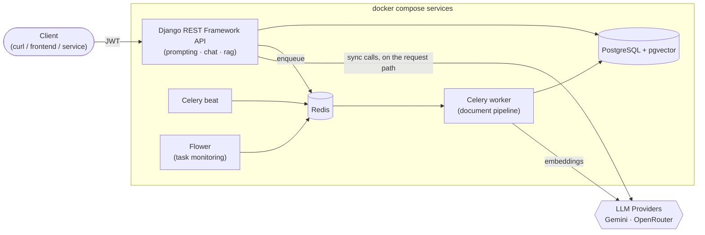
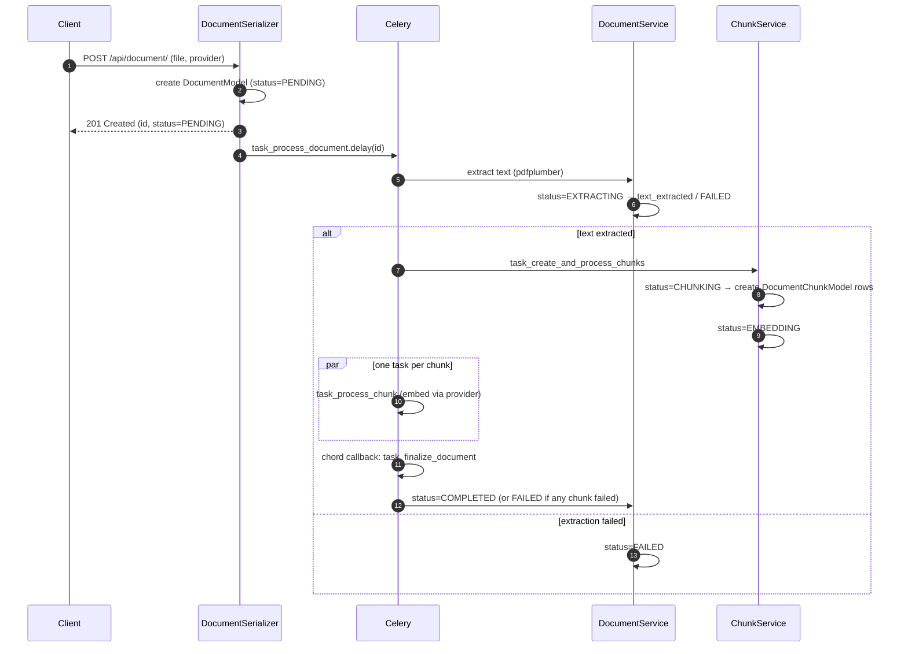
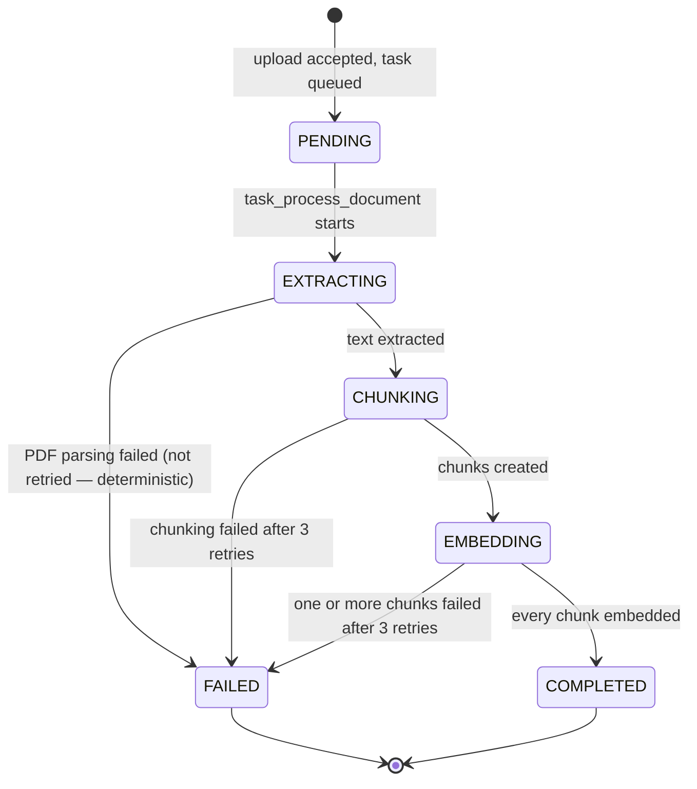
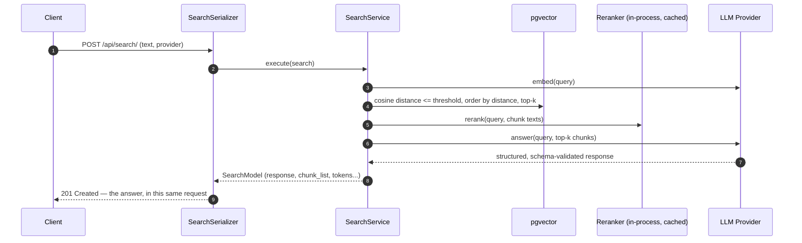
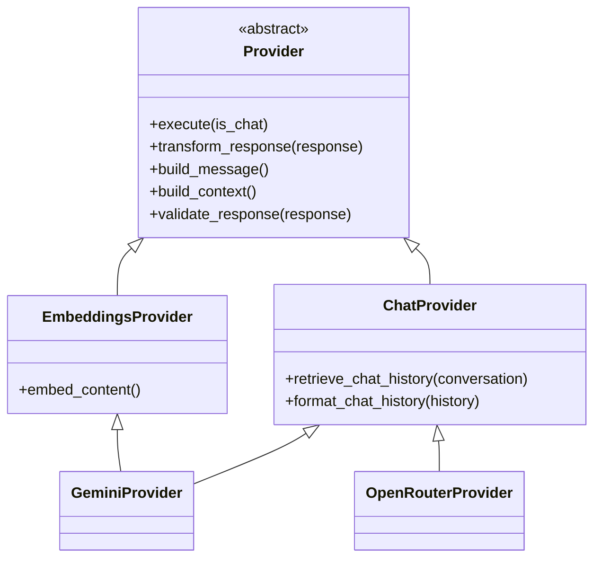

# LLM Platform API

A Django REST backend that ties together three things you'd normally see split across separate side projects: a **provider-agnostic LLM abstraction** (swap Gemini/OpenRouter without touching call sites), an **async-first RAG ingestion pipeline** (PDF → chunks → embeddings, orchestrated with Celery), and a **token-budgeted chat system**. It's API-only by design — a REST surface meant to be driven by any client (curl, a frontend, another service), not a bundled UI.

This README leads with *why* things are built the way they are, since that's usually more interesting than *what* the endpoints are.

## Contents

- [Architecture at a glance](#architecture-at-a-glance)
- [Design decisions worth reading](#design-decisions-worth-reading)
- [The RAG pipeline](#the-rag-pipeline)
- [The search pipeline](#the-search-pipeline-synchronous-by-design)
- [Provider abstraction](#provider-abstraction)
- [Tech stack](#tech-stack)
- [Project structure](#project-structure)
- [API reference](#api-reference)
- [Getting started](#getting-started)
- [Environment variables](#environment-variables)
- [Adding a new LLM provider](#adding-a-new-llm-provider)
- [Known limitations / roadmap](#known-limitations--roadmap)

## Architecture at a glance



Three Django apps, each independently useful and homologated to the same internal shape (`models/ serializers/ services/ schemas/ views/ admin/`):

| App | Responsibility |
|---|---|
| `prompting` | One-shot prompt → structured output (summarize / classify / extract keywords), plus the shared LLM provider abstraction every app builds on |
| `chat` | Multi-turn conversations with token-budgeted history windowing |
| `rag` | Document ingestion (PDF → chunks → embeddings) and retrieval-augmented search over pgvector |

## Design decisions worth reading

**Providers are swappable through one abstract interface, not scattered `if provider == "gemini"` checks.** `Provider` (`prompting/providers/base.py`) defines the contract (`execute`, `transform_response`, `build_message`, `build_context`); `GeminiProvider` and `OpenRouterProvider` implement it, and every caller goes through `factoryProvider(name)` (`prompting/factory/provider.py`). Adding Claude or OpenAI later is a new class + one registry line — see [Adding a new LLM provider](#adding-a-new-llm-provider).

**Every LLM response is validated against a pydantic schema before it's trusted.** Each provider's `transform_response` calls `validate_response()`, which runs the raw JSON through the schema declared for that call (`prompting/schemas/`, `rag/schemas/`) and raises rather than silently passing malformed output downstream.

**Document ingestion is async; search is not — deliberately.** Uploading a PDF doesn't need to block the HTTP response on minutes of parsing/embedding, so it's a Celery pipeline (see below). A search request *is* the response the client is waiting for — embed query → fetch top-k → rerank → ask the LLM are each a hard dependency of the next, and the last one **is** the answer body. Pushing any of those through Celery would just add a broker round-trip on top of work you still have to wait for, with nothing to decouple.

**Every Celery task in the document pipeline retries with backoff, then fails loud onto the record.** `max_retries=3, retry_backoff=4` on each task; once retries are exhausted, the failure is written to `document.error` / `chunk.error_embedding` and `document.status` so a client polling the document can see exactly what happened instead of a request just hanging or 500ing.

**Knowing when a document is "done" needs a `chord`, not a loop.** Chunk embeddings run as parallel Celery tasks — a plain `for chunk in chunks: task.delay(...)` has no way to know when the *last* one finishes. `task_create_and_process_chunks` groups them in a `chord` whose callback (`task_finalize_document`) only fires once every chunk task has completed, and marks the document `COMPLETED` or `FAILED` based on their results.

**The reranker model loads once per worker process, not once per request.** It's a lazily-initialized, `functools.lru_cache`-memoized singleton (`rag/services/search.py`) — not built eagerly in `AppConfig.ready()`, since that would pay the load cost in every process that imports the app (migrations, unrelated management commands, other Celery workers), not just the ones that actually serve search.

**Errors are recorded on the record, not swallowed into a broken response.** Serializers used to catch exceptions and return a bare `{"Error": ...}` dict from `create()` — which DRF can't actually serialize (a `ModelSerializer` expects a model instance), turning every failure into an opaque 500. Serializers now return the (partially-updated, error-carrying) model instance instead, so failures are visible in the response body with the right shape.

## The RAG pipeline



`DocumentModel.status` is the single field a client polls to know where a document is:



## The search pipeline (synchronous by design)



No polling, no task id to check later — the tradeoff is that a slow provider call or a cold reranker load is felt directly in request latency, which is why the reranker singleton (above) matters.

## Provider abstraction



`factoryProvider("gemini" | "openrouter")` returns the class; `promptsFactory(output_type)` returns the pydantic schema + system prompt for one-shot prompts. Every provider call's output is validated against a schema before it reaches a serializer.

## Tech stack

| Layer | Choice |
|---|---|
| API | Django 6 + Django REST Framework, JWT auth (`simplejwt`), `drf-spectacular` (OpenAPI/Swagger) |
| Async tasks | Celery 5 + Redis (broker & result backend), Flower for monitoring |
| Database | PostgreSQL + `pgvector` (HNSW indexes, cosine distance) |
| LLM providers | Google Gemini (`google-genai`), OpenRouter |
| RAG | `pdfplumber` (PDF text/table extraction), `chonkie` + `tiktoken` (token-aware chunking), `fastembed` cross-encoder (reranking) |
| Validation | `pydantic` schemas for every structured LLM output |
| Packaging | `uv`, multi-stage Docker build (`builder` → `develop` / `production`) |

## Project structure

Every app follows the same internal layout — the point being that once you know one app, you know where to look in the others:

```
<app>/
├── models/        # Django ORM models
├── serializers/   # thin DRF serializers — validation + delegating to services
├── services/      # business logic (the actual "what happens")
├── schemas/       # pydantic models for structured LLM I/O (prompting, rag)
├── views/         # ModelViewSets, effectively routing only
├── admin/         # Django admin registration
└── tasks.py       # Celery tasks (rag only, for now)
```

```
myapp/          # settings, root urls, base model/serializer classes, Celery app
prompting/      # provider abstraction, factories, one-shot prompt endpoint
chat/           # conversations, messages, chat history windowing
rag/            # document ingestion pipeline, chunking, embeddings, RAG search
compose/django/ # entrypoint + celery/gunicorn start scripts used by the Dockerfile
```

## API reference

All endpoints below (except token issuance) require a JWT `Authorization: Bearer <token>` header. Full interactive docs (request/response schemas, try-it-out) are at `/api/docs/`.

| Method | Path | Purpose |
|---|---|---|
| `POST` | `/api/token/` | Obtain access/refresh JWT pair |
| `POST` | `/api/token/refresh/` | Refresh an access token |
| `GET/POST` | `/api/prompt/` | One-shot prompt → structured output (summarize / classify / extract_keywords) |
| `GET/POST` | `/api/conversation/` | Create/list conversations |
| `GET/POST` | `/api/message/` | Send a message, get the LLM's reply appended to the conversation |
| `GET/POST` | `/api/document/` | Upload a PDF; kicks off the async ingestion pipeline |
| `GET/POST` | `/api/search/` | RAG search: query → embed → retrieve → rerank → answer (synchronous) |
| `GET` | `/api/docs/` | Swagger UI |
| `GET` | `/admin/` | Django admin |

## Getting started

```bash
cp .env.example .env      # fill in the values — see Environment variables below
make build                # docker compose build
make up                   # starts web, db, redis, celery_worker, celery_beat, flower
make migrate              # apply migrations
make superuser            # create an admin/API user
```

Then:
- API docs: `http://localhost:8000/api/docs/`
- Admin: `http://localhost:8000/admin/`
- Flower (task monitoring): `http://localhost:5557/`

See `makefile` for the rest of the targets (`logs`, `bash`, `migrations`, `restart`, `rebuild-web`).

## Environment variables

| Variable | Purpose |
|---|---|
| `SECRET_KEY` | Django secret key |
| `DEBUG` | `1` for Django debug mode |
| `ALLOWED_HOSTS` | Comma-separated hostnames |
| `POSTGRES_DB`, `POSTGRES_USER`, `POSTGRES_PASSWORD`, `POSTGRES_HOST`, `POSTGRES_PORT` | Database connection |
| `GEMINI_API_KEY`, `GEMINI_AI_MODEL`, `GEMINI_EMBEDDING_MODEL` | Gemini provider (chat/prompt model + embedding model) |
| `OPENROUTER_API_KEY`, `OPENROUTER_MODEL`, `OPENROUTER_EMBEDDING_MODEL` | OpenRouter provider |
| `DEFAULT_EMBEDDING_DIMENTIONS` | Vector size for pgvector columns — must match the embedding model in use |
| `COSINE_DISTANCE_THRESHOLD` | Max cosine distance for a chunk to be considered a search candidate |
| `RERANKER_MODEL` | fastembed cross-encoder model name (defaults to `jinaai/jina-reranker-v2-base-multilingual`) |
| `CELERY_BROKER`, `CELERY_BACKEND` | Redis URLs for the Celery broker/result backend |
| `CELERY_TIMEZONE`, `CELERY_TASK_TRACK_STARTED`, `CELERY_TASK_TIME_LIMIT` | Celery runtime config |

## Adding a new LLM provider

1. Implement `Provider` (see `prompting/providers/base.py`) in `prompting/providers/LLMs/`.
2. Register it in `prompting/factory/provider.py`.
3. If it should support embeddings, also implement `EmbeddingsProvider.embed_content`.

## Known limitations / roadmap

Being upfront about the current gaps rather than hiding them:

- **API-only.** No bundled frontend — it's meant to be driven by any client.
- **The `production` Docker stage still defaults to Django's dev server**, not gunicorn (which is a declared dependency, with a ready-to-uncomment `CMD` line) — fine for local dev via `docker compose`, not yet meant for a real deploy.
- **Single-user auth model.** JWT via `simplejwt` works, but there's no per-user rate limiting on LLM calls beyond the token-endpoint throttle.
- **No streaming responses.** Chat and search both return the full LLM output in one response; token-by-token streaming (SSE/websockets) would be the natural next step for perceived latency.
